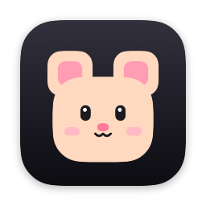

<p align="center">
  
</p>

<h1 align="center">Monty</h1>

<p align="center">
  A tiny mouse who lives in your MacBook's notch and types what you say.<br>
  Offline voice dictation and meeting notes in 20+ languages, powered by Gemma 4.
</p>

---

> **Work in progress.** Monty is used every day, but there is no ready-made download yet:
> you build it from this repository, which takes about 15 minutes the first time.
> Ideas and bug reports are very welcome in [Issues](../../issues).

## Contents

- [What Monty does](#what-monty-does)
- [What you need](#what-you-need)
- [Install, step by step](#install-step-by-step)
- [First launch](#first-launch)
- [How to use it](#how-to-use-it)
- [Meeting notes](#meeting-notes)
- [The Monty window](#the-monty-window)
- [Languages](#languages)
- [Where Monty keeps your data](#where-monty-keeps-your-data)
- [Troubleshooting](#troubleshooting)
- [Update](#update)
- [Uninstall](#uninstall)
- [How it works](#how-it-works)
- [License](#license)

## What Monty does

Hold **fn**, speak, let go: Monty writes your words wherever the cursor is, in any app
(Notes, Mail, Slack, WhatsApp, the browser, and so on).

You can speak in one language and get the text in another: talk in Urdu and get English,
or talk in English and get Roman Urdu, Spanish, Arabic, and more.

- 🎙 **Hold fn** to dictate into any app
- 🔒 **Tap fn twice** for hands-free, press fn again to finish, Esc to cancel
- 🌐 **fn + ⇧ (Shift)** switches between your two languages, A and B
- 📋 No text field selected? The text goes to the clipboard, ready to paste
- 📖 A custom dictionary for names and words, with automatic fixes for wrong spellings
- 📝 **Meeting notes** for Zoom, Google Meet, Teams, FaceTime, Slack and Discord calls
- 🐭 Monty lives in the notch: he listens, munches cheese while he thinks, and throws confetti when he is done
- 🔐 Everything runs on your Mac. No account, no cloud, nothing is sent anywhere

## What you need

| | |
|---|---|
| **Mac** | Apple silicon (M1 or later) recommended. A notch is nice but not required. |
| **macOS** | 14.2 (Sonoma) or later |
| **Memory** | 8 GB works, 16 GB is comfortable. The model uses 2 to 4 GB while loaded. |
| **Disk** | About 5 GB, mostly for the Gemma 4 model |
| **Software** | Apple's Command Line Tools, Ollama, and git (all free, installed below) |

## Install, step by step

Open the **Terminal** app (press ⌘ Space, type *Terminal*, press Return) and follow the steps.
Copy each command, paste it into Terminal, and press Return.

### 1. Install Apple's Command Line Tools

They bring the Swift compiler and git.

```bash
xcode-select --install
```

A window opens; click **Install** and wait until it finishes. If it says the tools are
already installed, go on to the next step.

### 2. Install Ollama

Ollama runs the AI model on your Mac. Download it from **[ollama.com/download](https://ollama.com/download)**,
open the downloaded file, and move Ollama to Applications. Start it once; a small llama
icon appears in the menu bar.

If you use [Homebrew](https://brew.sh), this works too:

```bash
brew install ollama
brew services start ollama
```

### 3. Download the Gemma 4 model

About 4.6 GB, so this can take a while:

```bash
ollama pull gemma4:e2b
```

When it says `success`, check that it is there:

```bash
ollama list
```

### 4. Get Monty

```bash
cd ~/Documents
git clone https://github.com/faheemmehdi/Monty.git
cd Monty/app
```

### 5. Create a signing certificate (once)

```bash
./setup-signing.sh
```

This makes a certificate named **Monty Local Signing** in your login keychain. It is only
used to sign Monty on this Mac, so macOS remembers the permissions you give Monty, even
after you rebuild it. If macOS asks for your password, it is your Mac login password.

### 6. Build and install

```bash
./build.sh run
```

The first build takes a minute or two. It installs **Monty** into your Applications folder
and starts it. You will see Monty's face in the menu bar and a window that opens with him.

## First launch

Monty needs a few permissions. macOS asks for each one once.

1. **Accessibility** (required). Monty listens for the fn key and types the text for you.
   When asked, click **Open System Settings** and turn on **Monty** under
   **Privacy & Security › Accessibility**. You may need to enter your password.
2. **Microphone** (required). Click **Allow** the first time you hold fn.
3. **System Audio Recording** (only for meeting notes), so Monty can hear the other people
   in a call. macOS asks the first time you start meeting notes.
4. **Documents folder**, so Monty can save notes and history in `Documents/Monty Data`.

Then one keyboard setting, so fn does not also open the emoji picker:

**System Settings › Keyboard › "Press 🌐 key to" › Do Nothing**

Want Monty to start with your Mac? In the Monty window go to **Settings › Startup** and turn
on **Open Monty when you log in**.

## How to use it

### Dictate

1. Click into any text field.
2. **Hold fn.** Wait for the small *tink* sound, then speak.
3. **Let go of fn.** In a second or two the text appears.

While you speak, the notch grows into a little black island: Monty on the left with his
ears twitching to your voice, a sound meter on the right. When the text is in, he shows a
green check and how many seconds it took.

### Hands-free

**Tap fn twice** quickly. A small orange lock appears in the notch, and you can talk without
holding any key. **Press fn once** to finish, or **Esc** to throw it away. Hands-free stops by
itself after five minutes.

### Switch languages

Monty keeps two languages, **A** and **B** (English and Roman Urdu at first).
**fn + ⇧** switches between them; Monty winks and shows the new one in the notch. Pick the
two languages in **Settings › Languages**.

### The notch panel

Rest the mouse on the notch for a moment: a panel slides out with Monty's status, the
A / B language switch, your last dictation with a copy button, and a ⚙ button that opens
the Monty window.

## Meeting notes

1. **Start or join a call** in Zoom, Google Meet, Microsoft Teams, FaceTime, Slack, Discord
   or Webex. Meetings in the browser (Chrome, Safari, Arc, Edge, Firefox, Brave) work too.
2. A few seconds later the notch asks **"Take notes?"**. Pick the notes language with 🌐
   and click **Start notes**. Please let the others know you are taking notes.
3. During the call the notch shows **Notes** and a timer. Your voice and the other people
   are recorded separately and written down as the meeting goes.
4. When the call ends (or you hover the notch and click **Stop**), Monty writes the notes:
   a title, a summary, key points, decisions and action items, followed by the full
   transcript, all in the language you picked.
5. Read them in the Monty window under **Notes**, or as Markdown files in
   `Documents/Monty Data/Meeting Notes`.

Said "Not now" and changed your mind? Hover the notch and click **Take notes**, or use
**Take notes from now** on the Notes page. For a call Monty did not notice, use
**Start notes anyway** on the Notes page or **Take Meeting Notes Now** in the menu bar.

**Tip:** wear headphones. On speakers the microphone also hears the other people; Monty
removes that echo, but headphones keep "You" and "Others" cleanly apart.

## The Monty window

Open it from Launchpad, Spotlight (*Monty*), the ⚙ in the notch panel, or **Settings…** in
the menu bar menu.

| Section | What is there |
|---|---|
| **Home** | Which language you are typing in, your recent dictations with copy buttons, stats and shortcuts |
| **Notes** | All meeting notes; click one to read it, copy it or show it in Finder |
| **Dictionary** | Words Monty should always spell your way |
| **Settings** | Languages A and B, microphone, model memory, startup |
| **About** | Version and a happy Monty |

### Dictionary

Add names and words Monty gets wrong. In **Word**, write it the way it should be. In
**Wrong spellings**, list how Monty wrote it, separated by commas. For example
`Jane Doe` with `Jain Doe, Jane Dough`. Those are replaced every time.

### Settings worth knowing

- **Keep microphone ready**: Monty starts listening instantly, so no word is cut off.
  macOS then shows the orange microphone dot all the time.
- **Keep Gemma in memory** (5 min, 30 min or Always): while the model is loaded a
  dictation takes about a second; right after it unloads, the first one takes about
  4.5 seconds.
- **Load Gemma when Monty starts**: turn off to keep memory free until you first speak.

## Languages

English, Roman Urdu, Urdu (Urdu script), Hinglish, Arabic, Czech, Danish, Dutch, French,
German, Hindi, Indonesian, Japanese, Korean, Portuguese, Russian, Spanish, Swedish, Thai,
Turkish and Vietnamese, plus **As Spoken** (clean up without translating).

You can speak in any language; the list is the language the text comes out in. Every
language in it passed three checks: Monty heard a spoken sentence correctly, translated it
to English without losing a detail, and wrote English speech correctly in that language.
More will be added as they pass. Ask for yours in Issues.

## Where Monty keeps your data

Everything Monty saves is in one folder, **Documents › Monty Data**:

| | |
|---|---|
| `Meeting Notes/` | one Markdown file per meeting |
| `History.json` | your recent dictations and the totals shown on Home |
| `Dictionary.txt` | your custom dictionary |
| `Logs/` | a debug log and the latest recording, for fixing problems |

Settings are kept where macOS keeps app settings, and the Gemma model stays with Ollama.
Open the folder from **Settings › Startup › Open folder** or **Open Monty Folder** in the menu.

## Troubleshooting

| Problem | Fix |
|---|---|
| Holding fn does nothing, or the emoji picker opens | Turn on Monty in **Privacy & Security › Accessibility**. If it is on, turn it off and on again. Also set **Press 🌐 key to** to **Do Nothing**. |
| "Ollama is not running" | Start the Ollama app (or `brew services start ollama`), then try again. |
| Nothing is typed, the notch shows a red ✕ | Monty heard no speech. Check the microphone in **Settings › Microphone** and in **System Settings › Sound › Input**. |
| The first word is cut off | Wait for the *tink* before speaking, or turn on **Keep microphone ready**. |
| The first dictation is slow | The model was loading. Set **Keep Gemma in memory** to 30 min or Always. |
| Monty's menu bar icon is missing | With many icons, macOS hides some behind the notch. Hold ⌘ and drag other icons out of the menu bar, or use the notch panel and the Monty window instead. |
| Meeting notes only have "You" | Allow **System Audio Recording** for Monty in **Privacy & Security**. |
| Permissions are gone after a rebuild | Run `./setup-signing.sh` once, then `./build.sh run` again, and allow the permissions one more time. |

Still stuck? Open an issue and attach `Documents/Monty Data/Logs/debug.log`. It contains
what Monty did, and may include text you dictated, so read it first.

## Update

```bash
cd ~/Documents/Monty
git pull
cd app
./build.sh run
```

Your settings, notes, history and dictionary stay as they are.

## Uninstall

1. Quit Monty (menu bar icon › **Quit Monty**).
2. Delete **Monty** from the Applications folder.
3. Delete the `Documents/Monty Data` folder, if you do not want to keep your notes.
4. In **System Settings › General › Login Items**, remove Monty if it is listed. In
   **Privacy & Security**, remove Monty from Accessibility, Microphone and System Audio Recording.
5. Optional: remove the settings, the model and the certificate:

```bash
defaults delete com.faheemmehdi.monty
ollama rm gemma4:e2b
```

Remove the certificate in the **Keychain Access** app: search for *Monty Local Signing*
and delete it.

## How it works

1. While fn is held, Monty records from the microphone.
2. Gemma 4 (e2b), running in Ollama on your Mac, listens to the audio and writes down what
   was said.
3. Gemma then rewrites it in the chosen language: fixes punctuation, removes "umm", and
   writes numbers as digits.
4. Monty pastes the result into the focused text field and puts your clipboard back.

For meeting notes, the microphone and the other apps' sound (through a Core Audio process
tap) are recorded separately and transcribed every 30 seconds. At the end, Gemma writes
the notes in English and translates them into the chosen language.

Native Swift and SwiftUI, no Electron. The app itself uses about 30 MB of memory.

### Project layout

- `app/` the Mac app: a Swift package, built with `build.sh` (no Xcode needed)
- `bench/` scripts used to compare speech models on recorded samples
- `docs/` images for this page

## License

MIT, see [LICENSE](LICENSE).
